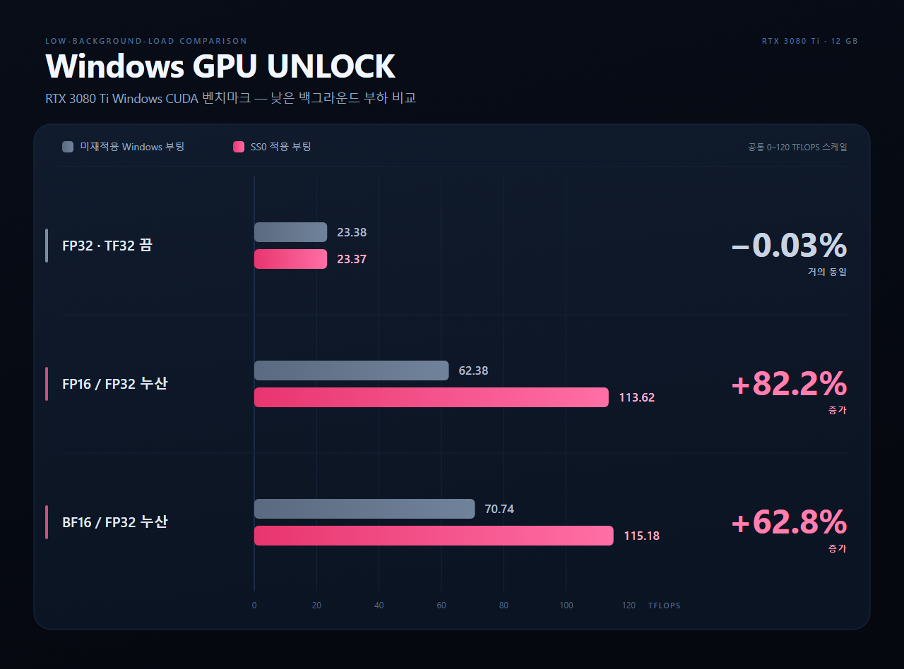

# RTX 3080 Ti Windows GPU UNLOCK

RTX 3080 Ti의 SS0 변경을 시험한 **실험용 소스와 재현 문서**입니다. 한 장비에서 GPU 펌웨어 실행, FLR(Function Level Reset), Windows 복귀와 아래 행렬곱 결과를 관측했습니다. 모든 RTX 3080 Ti에 적용되는 제품이나 원클릭 설치 프로그램이 아닙니다.

> **화면 소실·Windows 진입 실패·강제 종료에 따른 데이터 손실 위험이 있습니다. 실패 후 복구와 장시간 안정성은 보장하지 않습니다.** 소스를 내려받거나 에이전트에게 읽히는 것은 GPU 실행, 서명, USB 배치, Secure Boot 변경에 동의한 것이 아닙니다.

> **사용자 책임 안내:** 이 자료는 실험용입니다. 사용으로 발생하는 고장·오류·부팅 문제·데이터 손실 등 모든 문제와 수리·복구 비용은 사용자 본인 책임입니다. 제작자와 기여자는 이에 대한 책임이나 보상을 부담하지 않습니다. 자세한 내용은 [사용자 책임 안내](docs/DISCLAIMER.md)를 확인하세요.

## 측정 결과

| 행렬곱 | 미재적용 Windows 부팅 | SS0 적용 부팅 | 변화 |
|---|---:|---:|---:|
| FP32 · TF32 끔 | 23.38 TFLOPS | 23.37 TFLOPS | −0.03% · 거의 동일 |
| FP16 | 62.38 TFLOPS | 113.62 TFLOPS | +82.2% |
| BF16 | 70.74 TFLOPS | 115.18 TFLOPS | +62.8% |

2026-10-21의 한 쌍의 부팅에서 같은 검사 코드와 소프트웨어로 측정했습니다. 4096×4096 행렬곱, 표본당 20회, 5표본의 중앙값입니다. 양쪽 모두 사전 GPU 사용률 0%를 6회 확인하고 각 검사 프로세스 직전에도 0%를 확인했습니다. 클럭·전력은 고정하지 않았고, 전체 유한값 검사와 32행 표본 정확도 검사를 통과했습니다.

**행렬곱 처리량이지 모든 프로그램의 속도 향상률이 아닙니다.** 이전의 화면 부하가 섞인 기록은 이 표에 합치지 않았습니다. GPU FLR을 수행했으므로 “리셋 없이 적용”한 결과도 아닙니다. 세부 조건, 원자료의 공개용 정리본과 재현 명령은 [벤치마크 문서](docs/BENCHMARKS.md)를 참조하세요.

## 확인한 범위

| 항목 | 관측한 구성 |
|---|---|
| GPU / PCI ID | NVIDIA GeForce RTX 3080 Ti, `10de:2208` |
| Subsystem ID | `10de:1535` |
| VRAM | `nvidia-smi` 기준 12288 MiB |
| VBIOS | `94.02.71.00.83` |
| Windows NVIDIA 드라이버 | `617.42` |
| 계산 환경 | PyTorch `2.13.0+cu130`, CUDA `13.0` |
| 변경 | SS0 `0x01505166` → `0x88888888`, SS1 `0x6` 보존 |
| 실행 경로 | UEFI → 펌웨어 실행 → GPU FLR → Windows 복귀 |

대상 ID가 같아도 보드·VBIOS·플랫폼·보안 정책 차이 때문에 실패할 수 있습니다. 다른 subsystem, VRAM, GPU, VBIOS, 드라이버와 Linux 모듈의 실기 동작은 이 결과로 검증되지 않습니다. 소스의 대상 제한을 지워 다른 보드에 맞추지 마세요. 새로 빌드한 EFI도 기존 시험 바이너리와 별개의 산출물입니다.

## Codex·Claude로 이어서 점검하기

이 저장소를 읽을 수 있는 에이전트에게 다음과 같이 요청하세요.

> `AGENTS.md`와 `docs/AGENT_HANDOFF.md`를 읽고 내 PC의 적용 가능성을 먼저 읽기 전용으로 점검해 줘. 저장소의 관측 결과와 내 PC의 현재 상태를 구분하고, 변경 작업은 대상과 위험을 설명한 뒤 별도 승인을 받아 줘. GPU 실행이나 재부팅을 자동으로 시작하지 마.

- [공통 인계 절차](docs/AGENT_HANDOFF.md): 환경 확인, 준비, 승인, 단회 시험, 결과 판정과 중단 경계.
- [소스 빌드](docs/BUILD.md): 의존성, 오프라인 검사, 세 종류의 EFI와 준비 폴더.
- [벤치마크](docs/BENCHMARKS.md): 부하 통제, 계산 조건, 정확도와 비교 한계.
- `AGENTS.md`와 `CLAUDE.md`는 같은 공통 절차를 가리킵니다. 도구나 파일 접근이 없는 에이전트는 직접 확인했다고 주장할 수 없습니다.

## 포함하지 않는 것

서명된 EFI, NVIDIA 펌웨어 바이너리, 개인키·인증서, 실제 USB 설정, 특정 PC의 Windows 파티션 GUID, 자동 부팅 설치 프로그램은 포함하지 않습니다. Secure Boot 인증서 등록이나 범용 서명·USB 배치 자동화도 제공하지 않습니다. 따라서 이 소스만으로 다른 PC에서 즉시 부팅 가능한 USB가 완성되지는 않습니다.

`uefi/prepare_usb.py`는 별도로 빌드한 파일을 **새 일반 폴더에 준비하는 도구**입니다. USB를 포맷하거나 Windows ESP/BCD/BootOrder를 설치·변경하는 도구가 아닙니다. 준비 완료, 실물 실행 승인, 실행 성공은 각각 다릅니다.

## 출처와 라이선스

소스 계보와 핀된 upstream 정보는 `SOURCE.json`, 소스 라이선스는 [LICENSE](LICENSE)와 `licenses/`에 있습니다. 기존 저작권·GPL 및 GNU EFI 고지를 유지합니다. [NVIDIA 펌웨어 고지](firmware/NOTICE.md)는 별도이며, 소스 라이선스가 NVIDIA 펌웨어 재배포를 허가하지 않습니다.

이 공개본은 펌웨어를 동봉하지 않습니다. 로컬 준비 도구는 핀된 출처와 SHA-256으로 자산을 확인하며, 실제 사용·배포 전에 해당 약관을 별도로 검토해야 합니다.
